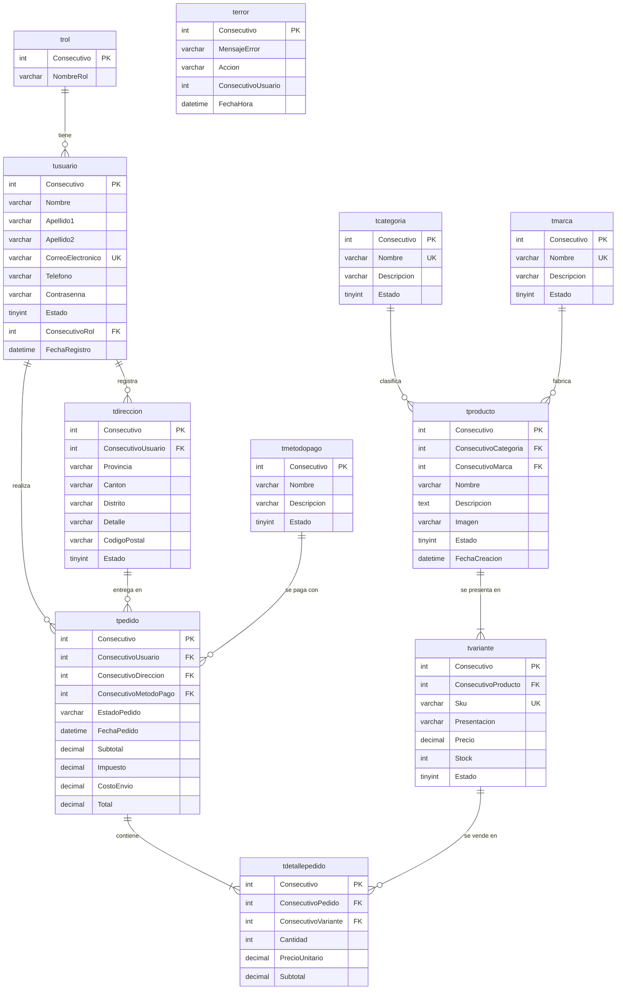

# Modelo de datos de Lifty (versión S02)

Base de datos `lifty_bd`, compatible con MySQL y con MariaDB de XAMPP. El script completo
(tablas, datos de ejemplo y procedimientos almacenados) está en `lifty/lifty_bd.sql`.

## 1. Validación del alcance

El profesor indicó que la base de la entrega 1 "se ve bien y un poco amplia". El modelo
pasó de **16 a 11 tablas**, conservando todo lo que los requerimientos necesitan.

| Tabla de la entrega 1 | Decisión | Justificación |
|---|---|---|
| `LIFTY_ESTADO_TB` | Eliminada | Cada tabla tenía una llave a Estado. Un borrado lógico solo necesita saber si algo está activo o no: se reemplaza por la columna `Estado` (1 o 0). El estado del pedido, que sí tiene cinco valores, es una columna `EstadoPedido` con los valores definidos en RF-21. Esto quita 11 llaves foráneas. |
| `LIFTY_TOKEN_RECUPERACION_TB` | Eliminada | La recuperación usa una contraseña temporal por correo (mecanismo del curso). No hay token ni vencimiento que guardar (RF-04). |
| `LIFTY_CARRITO_TB` y `LIFTY_DETALLE_CARRITO_TB` | Eliminadas | El carrito no descuenta stock ni necesita persistir entre dispositivos; vive en la sesión del servidor (RF-15). Lo que se guarda es el pedido. |
| `LIFTY_NOTIFICACION_TB` y `LIFTY_TIPO_NOTIFICACION_TB` | Eliminadas | El curso solo exige una notificación por correo. No se guarda historial de envíos; los fallos se registran en `terror` (RF-23). |
| (nueva) `terror` | Agregada | Registro de errores técnicos, como en las prácticas del curso (RN-13). |

Se conservan: roles, usuarios, direcciones, categorías, marcas, productos, variantes,
métodos de pago, pedidos y detalle de pedido.

## 2. Convenciones

Las del curso: tablas con prefijo `t` en minúsculas, llave primaria `Consecutivo`, columnas
en PascalCase, llaves foráneas `ConsecutivoXxx`, índices únicos `UK_tabla_Columna`,
llaves foráneas `FK_tabla_Columna` y procedimientos almacenados con prefijo `sp`.

## 3. Diagrama entidad-relación

## 4. Cardinalidades y restricciones

| Relación | Cardinalidad | Restricción |
|---|---|---|
| `trol` a `tusuario` | 1 a N | Todo usuario tiene exactamente un rol. |
| `tusuario` a `tdireccion` | 1 a N | Las direcciones se inactivan, no se borran, para conservar los pedidos. |
| `tusuario` a `tpedido` | 1 a N | |
| `tdireccion` y `tmetodopago` a `tpedido` | 1 a N | Cada pedido guarda la dirección y el método con los que se hizo. |
| `tpedido` a `tdetallepedido` | 1 a N (mínimo 1) | El detalle guarda el precio unitario del momento. |
| `tproducto` a `tvariante` | 1 a N | El precio y el stock viven en la variante. |
| `tcategoria` y `tmarca` a `tproducto` | 1 a N | |
| `tusuario.CorreoElectronico` | único | Es la credencial de inicio de sesión. |
| `tvariante.Sku` | único | |

## 5. Normalización

- **1FN:** todas las columnas son atómicas (la dirección se separa en provincia, cantón, distrito y señas; el nombre en nombre y apellidos).
- **2FN:** todas las tablas tienen llave primaria simple (`Consecutivo`), por lo que no hay dependencias parciales. Los datos de un producto que cambian por presentación (precio, stock) están en `tvariante`.
- **3FN:** no hay dependencias transitivas: el nombre de la categoría o de la marca no se repite en el producto; el nombre del método de pago y los datos del cliente no se copian al pedido. Las únicas columnas derivadas son los montos del pedido (`Subtotal`, `Impuesto`, `CostoEnvio`, `Total`) y `Subtotal` del detalle, que se guardan a propósito como registro histórico: si cambian el IVA o los precios, los pedidos ya hechos no deben cambiar (RN-05).

## 6. Procedimientos almacenados

Todo el acceso a datos pasa por procedimientos, agrupados así:

| Grupo | Procedimientos |
|---|---|
| Errores | `spRegistrarError` |
| Usuarios | `spRegistrarUsuario`, `spIniciarSesionUsuario`, `spConsultarCorreo`, `spConsultarContrasenna`, `spActualizarContrasenna`, `spConsultarUsuario`, `spActualizarDatosCuenta`, `spConsultarUsuarios`, `spActualizarEstadoUsuario` |
| Direcciones | `spConsultarDirecciones`, `spRegistrarDireccion`, `spActualizarDireccion`, `spInactivarDireccion` |
| Catálogo | `spConsultarCategorias`, `spRegistrarCategoria`, `spActualizarCategoria`, `spConsultarMarcas`, `spRegistrarMarca`, `spActualizarMarca`, `spConsultarProductosAdmin`, `spConsultarCatalogo`, `spConsultarProducto`, `spRegistrarProducto`, `spActualizarProducto`, `spConsultarVariantes`, `spConsultarVariante`, `spRegistrarVariante`, `spActualizarVariante` |
| Compra | `spConsultarMetodosPago`, `spActualizarEstadoMetodoPago`, `spRegistrarPedido`, `spRegistrarDetallePedido`, `spPagarPedido`, `spConsultarPedidos`, `spConsultarPedido`, `spConsultarDetallePedido`, `spActualizarEstadoPedido` |
| Reportes | `spConsultarResumen`, `spReportePedidosPorEstado`, `spReporteStockBajo` |

Dos de ellos concentran la lógica transaccional:

- `spPagarPedido`: dentro de una transacción comprueba que el pedido sea del usuario y esté Pendiente y que cada variante tenga stock suficiente y esté activa; entonces descuenta el stock y pasa el pedido a Pagado. Si algo falla, revierte.
- `spActualizarEstadoPedido`: al cancelar un pedido Pagado o Enviado devuelve el stock de sus líneas.

## 7. Diferencias respecto a la entrega 1

| Tema | Entrega 1 | S02 |
|---|---|---|
| Tablas | 16, prefijo `LIFTY_` y sufijo `_TB` | 11, convención del curso (`t` + nombre) |
| Llave primaria | `ID_<TABLA>` | `Consecutivo` |
| Estado | Tabla `ESTADO` con llave en cada tabla | Columna `Estado` (activo o inactivo) y `EstadoPedido` |
| Contraseña | `VARCHAR(255)` con hash | igual, con `password_hash` |
| Recuperación | Token con vencimiento | Contraseña temporal por correo |
| Carrito | Tablas | Sesión |
| Notificaciones | Tablas | Solo envío de correo |
